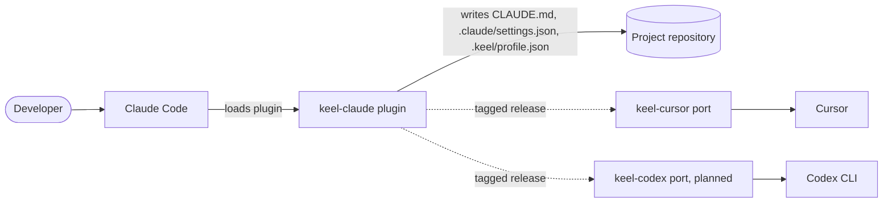
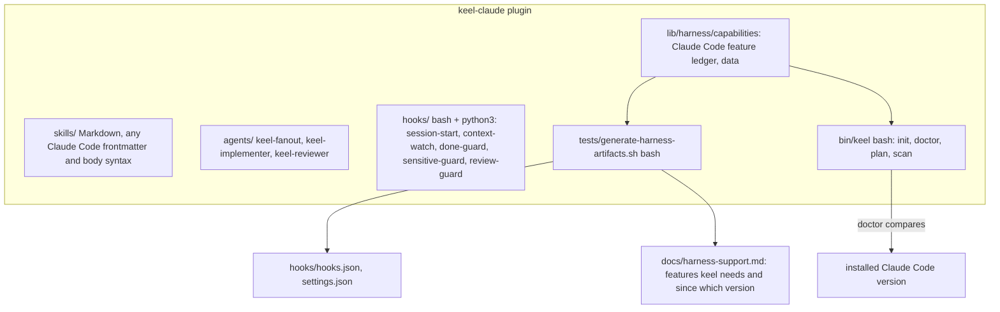
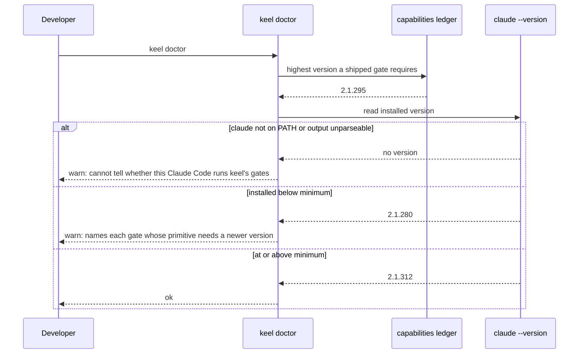

# Architecture: keel on Claude Code only

| | |
|---|---|
| Status | accepted 2026-10-29 |
| Mode | existing |
| Date | 2026-10-29 |
| Requirements | No PRD. Driver is Bernard's request of 2026-10-29: an independent keel Codex plugin is planned, as one exists for Cursor, and Codex support leaves this repository so Claude Code features can be used without limitation. The idea record [`docs/ideas/claude-code-features-assessed-2026-10-29.md`](../ideas/claude-code-features-assessed-2026-10-29.md) waits on this design |
| Stories | None |
| Extends | [`docs/architecture/tiered-multi-harness-support.md`](tiered-multi-harness-support.md), which it reverses, and [`docs/01-architecture.md`](../01-architecture.md) |
| ADRs | ADR-0013 (supersedes ADR-0004 and ADR-0005), ADR-0014 (supersedes ADR-0003), both accepted 2026-10-29 |

## 1. Summary

keel stops supporting more than one harness. This repository becomes a Claude Code plugin and
nothing else, free to use any Claude Code feature in its skills, agents, hooks and settings, and
every other harness is served by a separate port that generates from a pinned keel tag and owns its
own translation, the way `keel-cursor` already does. What the shape optimises for is that **no
decision in this repository is ever held back by what another harness lacks**, while the one
property ADR-0003 existed for survives in a narrower form: no gate is claimed on a Claude Code
version that cannot run it.

## 2. Forces

| Force | Source | Weight |
|---|---|---|
| Claude Code features are adopted without a per-harness gate or a neutral-wording rule | Bernard, 2026-10-29 | **Dominant** |
| Nobody holds a belief about a gate the code does not deliver | ADR-0003's dominant force | High. It now applies across Claude Code versions instead of across harnesses |
| Codex users are not stranded before `keel-codex` exists | Release continuity | High |
| Ports generate from a pinned tag and break silently on what they cannot translate | `keel-cursor/tools/sync-from-keel.sh` has no frontmatter allowlist and treats a rule that no longer matches as a warning | Medium. Their CI owns it, this repository does not |
| The removal is large: 8 Codex-only files, about 45 shared files, about 600 test assertions | The 2026-10-29 inventory | Medium. It sets the plan's size, not the shape |

The dominant force is the one the 2026-09-05 design traded away. That design accepted a Claude-only
gate as a two-strength guarantee to be disclosed. This one removes the second strength by removing
the second harness.

## 3. Approaches considered

**A. Claude-native upstream, ports downstream (chosen).** Delete every Codex path. This repository
is the source of truth and promises the ports nothing beyond its tags and its CHANGELOG. `keel-codex`
copies `keel-cursor`'s pattern: a generator over a pinned tag, rewrite rules, its own hooks, its own
capability manifest. Cost: the ports carry all translation, and a Claude-only feature adopted here
reaches a port as text it must handle. Forecloses: a shared skill body that is correct on every
harness by construction. Wrong if the ports cannot keep up, so that every keel release leaves them
further behind.

**B. Claude-native upstream with a portable core.** The same deletion, but skill bodies stay
harness-neutral under ADR-0005 and the validator enforces it. Claude-only features are allowed in
frontmatter, agents and hooks only. Cost: body features such as `` !`cmd` `` dynamic context and
`${CLAUDE_SKILL_DIR}` stay off limits. Lost because it keeps the very limitation the request names.

**C. A shared skills repository.** Skills move to their own repository, and each plugin, this one
included, builds from it with a per-harness overlay. Cost: a fourth repository, an overlay format
and a build step here. Lost because Claude features would live in an overlay rather than in the
skill, which is a limitation with more machinery.

The choice was put to Bernard on 2026-10-29 and A was chosen, together with the three answers in
section 11.

## 4. Structure

**Stack, unchanged.** Bash 3.2 compatible scripts for `bin/keel`, `bin/keel-fleet` and the hooks;
Python 3 standard library for `lib/context_watch.py`, the hook decision logic and the generators;
Markdown for skills, agents and docs. No framework. Nothing new runs.





| Component | Responsibility after this change | Satisfies | Depends on |
|---|---|---|---|
| `lib/harness/capabilities` | The Claude Code feature ledger: which primitive each gate needs, the version that provides it, and the evidence. The highest version a shipped gate needs is keel's minimum | G2 | Nothing |
| `lib/harness/resolve.sh` | Answers "is this gate active" from the ledger. Kept because `hooks/sensitive-guard` and `keel doctor` consult it and the evidence rule lives in it | G2 | The ledger |
| `lib/harness/claude.sh` | Claude Code's writers for `keel init`. No longer one side of a two-file contract, so it may fold into `bin/keel` or stay; the plan decides | G1 | `bin/keel` |
| `bin/keel` | `init`, `doctor`, `plan`, `scan`. Loses `--harness`, `HARNESS_SET`, `harness_each`, `harness_set_for_repo`, the Codex trust parser and the `AGENTS.md` writes. `doctor` gains the minimum version check | G1, G2, G3 | The ledger, the resolver |
| `hooks/*` | Unchanged in purpose. Lose the Codex branches: the `CODEX_VERSION` and exit 2 block in `sensitive-guard`, the rollout reader in `done-guard` | G1 | python3 |
| `lib/context_watch.py` | Loses `_measure_codex`, the Codex window and the format switch | G1 | Transcripts |
| `tests/generate-harness-artifacts.sh` | Generates `hooks/hooks.json`, `settings.json` and `docs/harness-support.md` for one harness. Stops generating `hooks/hooks.codex.json` | G2 | The ledger |
| `skills/`, `agents/` | Free to use Claude Code frontmatter and body syntax. The Codex sentences and "where the harness has it" hedges go | G1 | Nothing |
| Ports (`keel-cursor`, `keel-codex`) | Outside this repository. Generate from a pinned tag and own their translation | G4 | A keel tag |

Deleted outright: `.codex-plugin/`, `hooks/hooks.codex.json`, `lib/harness/codex.sh`,
`tests/fixtures/transcripts/codex.jsonl`, and the Codex cases in the test files the inventory lists.
`docs/ideas/keel-on-codex.md`, the 2026-09-05 design and its stories stay as history, marked
superseded rather than deleted, because they explain why the current answer looks the way it does.

## 5. Data

| Data | Change | Who writes | Who reads |
|---|---|---|---|
| `lib/harness/capabilities` | The nine `provides|codex|...` rows and the Codex commentary go. `provides|claude|...` and `requires|...` rows stay, each with source, version and date | Contributors | `resolve.sh`, the generator, `keel doctor` |
| `.keel/profile.json` `harnesses` | Removed. `SCHEMA_VERSION` 6 to 7. A profile written before 7 keeps loading: the key is ignored and `keel profile sync` drops it | `keel init`, `keel profile sync` | Nothing after this change |
| `.keel/profile.json` gate keys | Unchanged | | |
| `.codex/config.toml`, `.codex/agents/*.toml` in user repositories | No longer written or read. Left in place where they exist | `keel init` before this change | `keel-codex`, once it exists |
| `AGENTS.md` in user repositories | No longer written or checked. An existing managed block is left as it is | `keel init` before this change | Other harnesses and their ports |

The minimum Claude Code version is **derived, not stored**: it is the highest version among the
`provides|claude` rows that a shipped gate requires, so adding a feature that needs a newer
Claude Code raises the minimum in the same edit. Nothing reconciles a stored copy because there is
none; README and `docs/harness-support.md` carry generated text, and the generated-artifact test
fails when they disagree with the ledger.

## 6. Critical paths

**`keel doctor` on a machine with an older Claude Code.**



`claude --version` slow or hung: doctor bounds the call and reports "cannot tell", never "ok".

**A port picks up a release.**

```mermaid
sequenceDiagram
    participant K as keel-claude
    participant P as port generator
    participant CI as port CI
    K->>K: tag vX.Y.Z, CHANGELOG lists features adopted
    P->>K: read skills at the pinned tag
    alt a rewrite rule no longer matches, or new Claude-only syntax appears
        P-->>CI: warning today in keel-cursor
        CI-->>P: should fail; the port's concern, see section 11
    else everything translates
        P-->>CI: regenerated skills, drift check clean
    end
```

This repository's part ends at the tag and the CHANGELOG. Whether a port fails loudly on what it
cannot translate is that port's decision.

## 7. Failure modes

| Failure | Detection | Behaviour | Recovery |
|---|---|---|---|
| Claude Code older than keel's minimum | `keel doctor` version check | A field newer than the client is ignored or the plugin refuses to load; doctor warns. Fails **open** for gates the client cannot run, which is why the warning names them | Update Claude Code |
| `claude --version` unavailable or unparseable | Doctor | Reports "cannot tell", never "ok". Fails **closed** in what it claims | None needed |
| A profile from schema 6 still lists `harnesses` with `codex` | `keel doctor` | Loads; doctor says once that this plugin no longer serves Codex and names `keel-codex` and the v0.26.0 tag | `keel profile sync` drops the key |
| A repository still holds keel-written `.codex/` files | `keel doctor` | Left alone, reported as not managed by this plugin | Delete them, or let `keel-codex` take them over |
| A stale `AGENTS.md` managed block | Not detected by this plugin | Left alone. Its readers are other harnesses | Their port's `init` rewrites it |
| A port silently ships Claude-only text it could not translate | Not detectable here | Cursor or Codex users read instructions naming features they lack | The port adds a frontmatter allowlist and fails on unmatched rules |
| A Codex user installs from `main` after this change | No `.codex-plugin/` exists, so Codex finds no plugin | Fails **closed**: nothing loads rather than a half-working gate | Install from the `v0.26.0` tag until `keel-codex` ships |
| `sensitive-guard` exits 2 for a reason other than the removed Codex block | The `EXIT` trap from PR #7 | With the deliberate exit 2 gone, the trap can map 2 to `ask` as well | The plan decides whether the trap's `0|2` becomes `0` |

## 8. Security architecture

The trust boundaries do not change: the hooks still run with the developer's permissions, and the
gates still answer from `.keel/profile.json`. Two things move.

- **`sensitive-guard` loses its Codex arm.** On Codex it exited 2 because Codex discards `ask`.
  With no Codex path, the only remaining decisions are `ask` and silence, which removes one branch
  from the most sensitive hook. Codex users keep v0.26.0's behaviour until they move to `keel-codex`.
- **Adopting `onFailure: "block"`** (item 1 of the idea record) becomes possible without a
  per-harness condition. It is gated on the minimum version this design derives.

No credential, secret or network call is added.

## 9. Operations

- **Release.** This is a breaking change for Codex users, so it ships as 0.27.0. The CHANGELOG and
  README state that v0.26.0 is the last release with Codex support and show installing that tag on
  Codex. `docs/runbooks/cutting-a-release.md` drops the `.codex-plugin/plugin.json` bump.
- **Ports.** `keel-cursor` is unaffected by the deletion, because it never read Codex files. It is
  affected by every Claude-only feature adopted after this lands; the CHANGELOG names each one.
- **Observed while designing, not caused by it.** `keel-cursor`'s generator reads `../keel`, the
  archived `keel-internal` checkout, and its drift workflow needs a token for that repository, so it
  cannot see any release after v0.25.0 from the public repository. Recorded for the port's
  maintainer.

## 10. Requirement coverage

No PRD exists. The goals stated in the request and the surviving force stand in for one.

| Goal | Addressed by | Note |
|---|---|---|
| G1. Claude Code features used without limitation | ADR-0013; deletion of every Codex path; skills and agents unconstrained | |
| G2. No belief about a gate the running Claude Code cannot deliver | ADR-0014; the ledger, the derived minimum, the doctor check | |
| G3. Codex users not stranded | Section 9: the v0.26.0 tag, CHANGELOG and README | `keel-codex` itself is out of scope |
| G4. Ports keep working | Section 6 and section 9 | Only to the extent of a tag and a CHANGELOG; the ports own the rest |
| Everything else | [`docs/01-architecture.md`](../01-architecture.md) | Not touched by this design |

## 11. Open questions

Answered by Bernard on 2026-10-29:

1. **Shape of the split:** Claude-native upstream, ports downstream (section 3, A).
2. **`AGENTS.md`:** `keel init` stops writing it; existing files are left untouched and `keel
   doctor` stops checking them.
3. **The harness layer:** slimmed to a Claude Code feature ledger that sets the minimum version;
   the multi-harness plumbing goes.
4. **Codex users:** removed in the next release, with v0.26.0 named as the last Codex release.

Still open, none blocking `write-plan`:

5. **Does `lib/harness/claude.sh` fold into `bin/keel`?** With no second implementation the
   six-function contract has no reason to exist. Deciding it is a refactoring choice for the plan.
6. **Does the `EXIT` trap in `sensitive-guard` stop exempting exit 2?** Depends on PR #7 landing
   first. The plan decides.
7. **Should `keel-cursor`'s generator move to the public repository and fail on unknown
   frontmatter?** The port's maintainer decides. It does not block this repository.

## On acceptance

Accepted 2026-10-29. ADR-0003, ADR-0004 and ADR-0005 carry `superseded by` status rows, and the
2026-09-05 design's header carries a `Superseded by` row pointing here.

## Next

`write-plan` for the removal. It lands before the plan for the idea record's items, which this
design changes.
